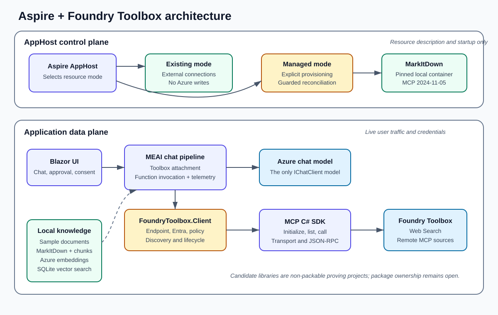
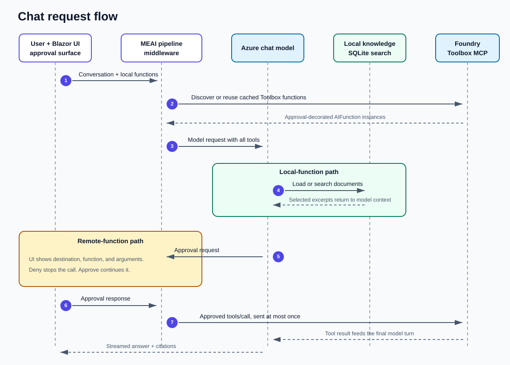
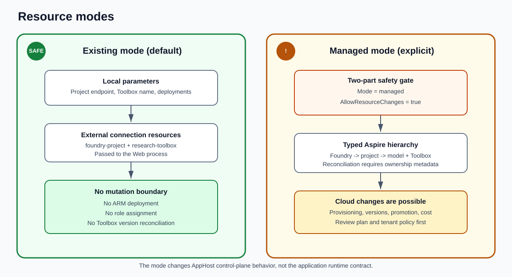

# Architecture

The sample separates the AppHost control plane from the application data plane.
This is the central design constraint.



## System boundaries

### AppHost process

`AspireFoundryToolboxChat.AppHost` describes resources and passes connection
information to the Web process.

It owns:

- Existing versus managed resource composition.
- MarkItDown container startup.
- Resource references, health ordering, and dynamic endpoints.
- Managed-mode Toolbox definition and reconciliation.

It does not open the Toolbox MCP session, participate in user conversations, or
hold request-time application credentials.

### Application process

`AspireFoundryToolboxChat.Web` owns live user traffic.

It composes:

```text
FoundryToolboxChatClient
  -> FunctionInvokingChatClient
     -> OpenTelemetryChatClient
        -> Azure model IChatClient
```

The outer Toolbox middleware discovers remote functions and appends them to a
cloned `ChatOptions`. The standard MEAI function-invocation middleware owns the
model/tool loop. The underlying model remains the only `IChatClient`.

### Host-neutral Toolbox runtime

`FoundryToolbox.Client` owns service behavior that is useful with or without
Aspire:

- Canonical consumer and pinned-version endpoint parsing.
- Entra token acquisition for `https://ai.azure.com/.default`.
- The `Foundry-Features: Toolboxes=V1Preview` header.
- MCP initialization, discovery, invocation, reconnect, and disposal.
- Strict approval metadata and OAuth-consent translation.
- Canceled, capped discovery cleanup without replaying `tools/call`.
- Connection leases that let dispatched calls drain before refresh retires
  their MCP session.
- `AIFunction` projection and optional MEAI request middleware.

It depends on the official MCP C# SDK for transport and protocol mechanics. It
has no Aspire, hosted-agent, UI, health-check, or application-tool dependency.

### Aspire client integration

`Aspire.Foundry` adapts application configuration into:

- `AIProjectClient`.
- A standalone or project-associated `FoundryToolboxClient`.
- Keyed and unkeyed dependency injection.
- Eager startup, readiness health checks, traces, and metrics.

The Web project references this integration rather than constructing the
runtime directly.

### AppHost Toolbox integration

`Aspire.Hosting.Foundry.Toolbox` models a project-parented Toolbox and its
managed reconciliation pipeline. It has no reference to the runtime client.
The local project is a staging boundary for a possible contribution to the
existing `Aspire.Hosting.Foundry` package.

## Chat request flow



1. The UI sends the conversation and local `AIFunction` instances to the MEAI
   pipeline.
2. `FoundryToolboxChatClient` obtains the cached remote Toolbox functions and
   appends them without mutating caller-owned options.
3. The Azure model chooses whether to answer directly or call a function.
4. Local search runs in-process against SQLite. Its returned excerpts become
   context on the next model turn.
5. Every remote Toolbox function is wrapped with
   `ApprovalRequiredAIFunction` by application policy.
6. The UI shows the Toolbox destination, function name, and arguments. A denied
   call does not reach the remote source.
7. After approval, the function invokes Foundry Toolbox through the MCP SDK.
8. Tool output returns to the model, which produces the final streamed answer
   and citations.

Tool calls are serial in this sample. `tools/call` is sent at most once by the
runtime. A transport failure after dispatch is treated as indeterminate rather
than retried.

## Local document flow

```text
wwwroot/Data files
  -> local MarkItDown MCP container
  -> chunking
  -> Azure embedding deployment
  -> local SQLite vector store
  -> local semantic search
  -> selected excerpts
  -> Azure chat model
```

"Local" refers to file storage, parsing, indexing, and vector search. It does
not mean document content never leaves the process. Document chunks are sent
to the embedding service, and selected excerpts are sent to the chat model.

## Resource modes



### Existing mode, default

The AppHost creates only external connection resources:

```csharp
var foundryProject = builder.AddConnectionString("foundry-project");
var toolbox = builder.AddConnectionString("research-toolbox");
```

This is a deliberate bridge. The current typed Foundry existing-project path
still emits implicit Application Insights and role-assignment children. A
connection resource is less descriptive, but it proves a no-mutation boundary.

Existing mode:

- Reads parameters from local configuration.
- Passes endpoints and names to the Web application.
- Does not deploy Azure resources.
- Does not create, promote, or reconcile Toolbox versions.

### Managed mode, explicit

Managed mode uses the native project-parented shape:

```csharp
var project = builder.AddFoundry("foundry")
    .AddProject("foundry-project");

var toolbox = project.AddToolbox("research-toolbox")
    .WithWebSearchTool()
    .WithMcpTool(
        "microsoft-learn",
        new Uri("https://learn.microsoft.com/api/mcp"),
        "Search Microsoft Learn.",
        approval: ToolboxApprovalMode.Always);
```

It requires both `Foundry:Toolbox:Mode=managed` and
`Foundry:Toolbox:AllowResourceChanges=true`. The reconciliation layer changes
only Toolboxes carrying its ownership metadata and reuses a matching immutable
version by configuration hash.

## Dependency direction

```text
AspireFoundryToolboxChat.AppHost
  -> Aspire.Hosting.Foundry.Toolbox
     -> Aspire.Hosting.Foundry

AspireFoundryToolboxChat.Web
  -> Aspire.Foundry
     -> Azure.AI.Projects
     -> FoundryToolbox.Client
        -> ModelContextProtocol
        -> Microsoft.Extensions.AI
```

Dependencies point inward toward the host-neutral runtime. No runtime project
references AppHost, and no AppHost integration references the runtime.

## Project map

| Path | Start here when investigating |
|---|---|
| `AspireFoundryToolboxChat.AppHost/AppHost.cs` | Resource topology, safe and managed modes, MarkItDown |
| `AspireFoundryToolboxChat.Web/Program.cs` | MEAI pipeline, Azure clients, telemetry defaults, local storage |
| `AspireFoundryToolboxChat.Web/Components/Pages/Chat/Chat.razor` | Conversation, approvals, consent, errors, citations |
| `AspireFoundryToolboxChat.Web/Services/` | Local document tools, semantic search, ingestion, data paths |
| `FoundryToolbox.Client/FoundryToolboxClient.cs` | Runtime state, discovery, readiness, refresh, disposal |
| `FoundryToolbox.Client/FoundryToolboxConnector.cs` | MCP connection establishment and retry boundary |
| `FoundryToolbox.Client/FoundryToolboxFunction.cs` | At-most-once invocation and consent translation |
| `FoundryToolbox.Client/FoundryToolboxChatClient.cs` | MEAI request augmentation and approval policy |
| `Aspire.Foundry/ProjectClient/` | `AIProjectClient` registration |
| `Aspire.Foundry/Toolbox/` | Toolbox configuration, DI, health, startup, telemetry |
| `Aspire.Hosting.Foundry.Toolbox/` | AppHost model, connection properties, reconciliation |

## Deployment and ownership status

The sample proves package seams but does not claim final ownership:

| Local boundary | Possible destination |
|---|---|
| `FoundryToolbox.Client` | CommunityToolkit incubation, Azure SDK, or official MEAI integration after review |
| `Aspire.Foundry` | Aspire client integration, subject to API and package naming review |
| `Aspire.Hosting.Foundry.Toolbox` | Existing `Aspire.Hosting.Foundry` package |

See [Design decisions](design-decisions.md) for why these seams exist and
[Productionization](toolbox-productionization.md) for the upstream contribution
map.
